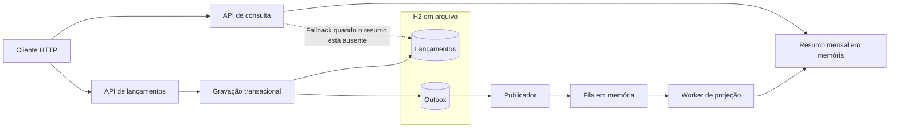

# Fluxo de Caixa — POC de Arquitetura

Registro transacional de lançamentos financeiros e consolidação assíncrona para consulta, em uma aplicação local com Java e Spring Boot.

A prova de conceito (POC) demonstra a separação entre escrita e leitura, a gravação de eventos com o padrão outbox e a construção de um modelo de consulta. A base transacional é a fonte da verdade dos lançamentos.

**Escopo atual:** criação e listagem de lançamentos e resumo **mensal por empresa**, em um monólito modular. A visão da solução completa contempla consolidação diária, interface web, autenticação e infraestrutura em nuvem, descritas separadamente.

## O que a POC demonstra

| Capacidade | Implementação local |
| --- | --- |
| Escrita transacional | Lançamento e evento de outbox gravados na mesma transação no H2 |
| Separação entre comando e consulta | Módulos de escrita e leitura dentro de uma aplicação Spring Boot |
| Processamento assíncrono | Publicador agendado, fila em memória e worker de projeção |
| Consulta consolidada | Modelo de leitura mensal em memória, por empresa e mês de vencimento |
| Fallback | Recálculo a partir dos lançamentos quando o modelo de leitura está ausente |
| Diagnóstico e recuperação | Estatísticas da outbox, reprocessamento de publicações falhas e simulação de falha da projeção |
| Controle de requisições | Limite local por `X-Client-Id` |
| Observabilidade | Health check, logs e identificação da requisição HTTP com `X-Correlation-Id` |

## Visão rápida da arquitetura



O processamento da projeção ocorre após a gravação. `PUBLISHED` na outbox indica publicação na fila; a atualização do resumo deve ser conferida no modelo de leitura. Veja as [garantias e limitações](docs/arquitetura_poc.md#garantias-e-limitacoes).

## Início rápido

Pré-requisitos: **JDK 21**, **Maven** disponível no terminal e porta **8080** livre. O projeto utiliza Spring Boot **3.3.0**, conforme o [pom.xml](pom.xml). Não há Maven Wrapper no repositório.

Na raiz do projeto, em Bash ou PowerShell:

```text
java -version
mvn -version
mvn spring-boot:run
```

Em outro terminal, confira a disponibilidade da aplicação.

**Bash:**

```bash
curl -s http://localhost:8080/actuator/health
```

**PowerShell:**

```powershell
Invoke-RestMethod -Uri 'http://localhost:8080/actuator/health'
```

O resultado esperado contém `status: UP`. Para criar lançamentos e acompanhar os totais, siga o [roteiro de demonstração](docs/guia_execucao.md#demonstracao).

## Documentação

| Para entender… | Leia |
| --- | --- |
| O problema, os requisitos e a visão da solução completa | [Solução de fluxo de caixa](docs/solucao_fluxo_caixa_consolidada.md) |
| Os módulos, as decisões e os limites da implementação | [Arquitetura da POC](docs/arquitetura_poc.md) |
| Como executar, demonstrar, configurar e testar | [Guia de execução](docs/guia_execucao.md) |
| Os endpoints, os campos e as regras de cálculo | [Referência da API](docs/api.md) |

### Histórico de concepção

As especificações abaixo registram orientações de implementação. Para operar a versão atual, use os guias da tabela acima.

- [Especificação original da POC — GPT-5.4](docs/especificacao_gpt54_cashflow_poc.md)
- [Especificação de complementação — GPT-5.4 Mini](docs/especificacao_gpt54_mini_cashflow_poc.md)
- [Diagrama original editável — Excalidraw](docs/Cashflow-2026-05-30-1130.excalidraw)
- [Diagrama original em SVG](docs/assets/cashflow-excalidraw-diagram.svg)

## Limites do escopo

A POC executa em um único processo, com persistência de lançamentos e outbox em `data/`. Fila, projeções, controle de eventos processados e rate limit ficam em memória. Não há frontend, autenticação, autorização por empresa ou infraestrutura AWS implementados.

As metas de desempenho e disponibilidade da [visão da solução](docs/solucao_fluxo_caixa_consolidada.md#requisitos-nao-funcionais) são requisitos pretendidos; esta documentação não apresenta resultados de carga ou comprovação dessas metas.
