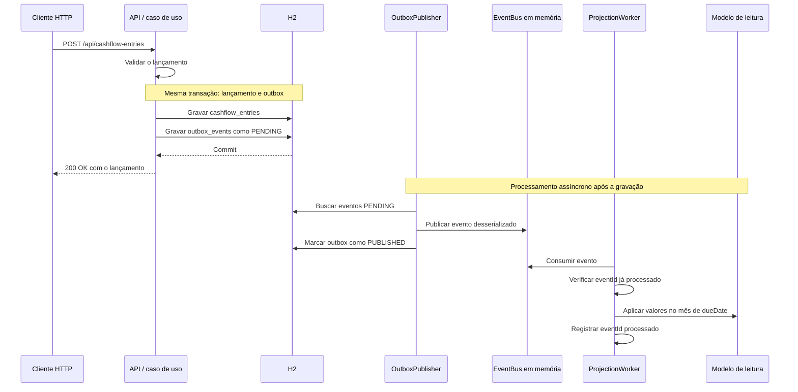
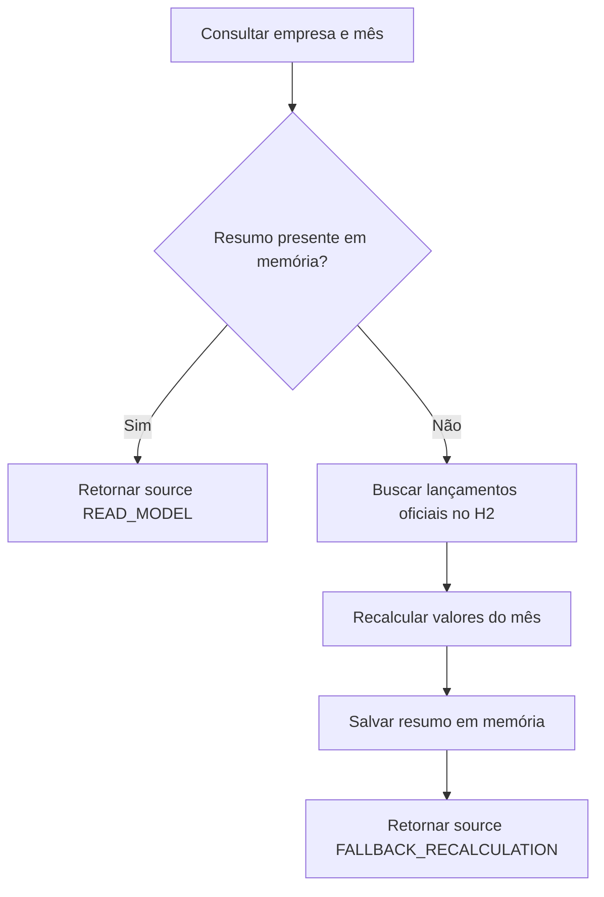

# Arquitetura da POC

[Início](../README.md) · [Visão da solução](solucao_fluxo_caixa_consolidada.md) · [Guia de execução](guia_execucao.md) · [API](api.md)

A implementação local é um **monólito modular em Java 21 e Spring Boot 3.3.0**. Comandos e consultas têm responsabilidades distintas, mas executam no mesmo processo. Lançamentos e outbox são persistidos no H2 em arquivo; transporte de eventos e projeções usam memória local.

## Conteúdo

- [Componentes e responsabilidades](#componentes-e-responsabilidades)
- [Fluxo de lançamento e projeção](#fluxo-de-lancamento-e-projecao)
- [Fluxo de consulta](#fluxo-de-consulta)
- [Persistência e estado em memória](#persistencia-e-estado-em-memoria)
- [Decisões e consequências](#decisoes-e-consequencias)
- [Garantias e limitações](#garantias-e-limitacoes)
- [Observabilidade](#observabilidade)
- [Evolução prevista](#evolucao-prevista)
- [Glossário](#glossario)

## Componentes e responsabilidades

Os pacotes estão em [src/main/java/com/example/cashflow](../src/main/java/com/example/cashflow).

| Módulo | Responsabilidade | Pontos de entrada principais |
| --- | --- | --- |
| `cashflow.command` | Validar, gravar e listar lançamentos oficiais | `CashFlowEntryController`, `CreateCashFlowEntryUseCase`, `ListCashFlowEntriesUseCase` |
| `outbox` | Persistir eventos, publicar pendências e controlar tentativas | `OutboxPublisher`, `OutboxDiagnosticsService` |
| `eventbus` | Transportar eventos dentro do processo | Contrato `EventBus`, implementação `InMemoryEventBus` |
| `cashflow.projection` | Consumir eventos e atualizar o resumo mensal | `CashFlowProjectionWorker` |
| `cashflow.query` | Consultar a projeção e recalcular um resumo ausente | `CashFlowSummaryQueryUseCase`, `CashFlowSummaryRecalculationService` |
| `ratelimit` | Limitar requisições por cliente em uma janela local | `RateLimitFilter`, `InMemoryFixedWindowRateLimiter` |
| `diagnostics` | Expor estado da outbox e da projeção e controlar falha simulada | `DiagnosticsController` |
| `shared` | Relógio, serialização, tratamento de erros e correlação HTTP | `ClockConfiguration`, `GlobalExceptionHandler`, `CorrelationIdFilter` |

Dentro dos módulos, `api` trata HTTP, `application` coordena os casos de uso, `domain` concentra os modelos e contratos, e `infrastructure` fornece persistência e outras implementações. Essa organização orienta a separação de responsabilidades; não representa serviços implantados separadamente.

## Fluxo de lançamento e projeção

A transação está em [CreateCashFlowEntryUseCase](../src/main/java/com/example/cashflow/cashflow/command/application/CreateCashFlowEntryUseCase.java). Ela vincula a gravação do lançamento à gravação de sua intenção de publicação. A fila em memória fica fora dessa transação.

O evento `CashFlowEntryCreated` contém a identificação do lançamento e os dados usados pela projeção: empresa, tipo, valor, categoria, conta, datas e status. O identificador da linha da outbox é gerado separadamente do `eventId` contido no payload; `aggregateId` identifica o lançamento.

### Agendamentos e falhas de publicação

| Componente | Configuração padrão | Comportamento |
| --- | --- | --- |
| Publicador | Intervalo de 2.000 ms, até 10 eventos por ciclo | Busca `PENDING`, publica na fila e marca `PUBLISHED` |
| Worker | Intervalo de 1.000 ms, até 20 eventos por ciclo | Consome eventos e atualiza a projeção |
| Retry da publicação | Máximo de 3 tentativas com falha | Registra erro e incrementa tentativas; ao atingir o limite, marca `FAILED` |

Os intervalos são `fixedDelay`: contam a espera após o término de uma execução. Eles não constituem prazo máximo de atualização do resumo.

O reprocessamento manual retorna eventos `FAILED` para `PENDING`, zera as tentativas e limpa o último erro. Ele trata **falhas de publicação**. O modo de falha da projeção devolve o evento à fila e interrompe aquele ciclo do worker; após desativá-lo, o worker pode tentar novamente enquanto o processo continuar ativo.

## Fluxo de consulta

O fallback consulta a tabela de lançamentos, não a outbox. A consulta seguinte pode utilizar o resumo salvo em memória. Quando não há lançamentos para a empresa e o mês, o recálculo produz valores e contagem zerados.

O [caso de uso de consulta](../src/main/java/com/example/cashflow/cashflow/query/application/CashFlowSummaryQueryUseCase.java) verifica a existência da projeção. Não verifica automaticamente se uma projeção existente está atrasada, parcial ou divergente. As [regras dos totais](api.md#regras-do-resumo) descrevem o cálculo atual.

## Persistência e estado em memória

| Estado | Local | Efeito do reinício |
| --- | --- | --- |
| Lançamentos | Tabela `cashflow_entries`, H2 em arquivo | Permanecem no mesmo caminho de dados |
| Outbox e tentativas | Tabela `outbox_events`, H2 em arquivo | Permanecem; publicador volta a buscar `PENDING` |
| Eventos publicados na fila | `LinkedBlockingQueue` | São perdidos |
| Resumos mensais | `ConcurrentHashMap` | São perdidos; uma consulta pode reconstruir um resumo ausente |
| IDs processados pelo worker | Conjunto em memória | São perdidos |
| Contadores do rate limit | Mapa em memória | São reiniciados |
| Modo de falha simulado | Flag em memória | Volta a desativado |

O H2 mantém os dados em `./data/cashflow`, relativo ao diretório em que a aplicação é iniciada. A configuração utiliza `ddl-auto=update`; não existe uma sequência de migrações versionadas no projeto.

## Decisões e consequências

| Decisão | Motivo no contexto da POC | Consequência |
| --- | --- | --- |
| Monólito modular | Executar localmente com menos dependências operacionais | Separação lógica; sem isolamento de falhas entre processos |
| H2 em arquivo | Persistir dados sem instalar um servidor de banco | Ambiente local diferente do PostgreSQL previsto na solução completa |
| Outbox transacional | Registrar lançamento e intenção de publicação de forma atômica | Publicação e projeção continuam sendo etapas posteriores |
| Separação de comando e consulta | Demonstrar uma visão derivada otimizada para leitura | A consulta pode apresentar atraso em relação à escrita |
| Fila e projeção em memória | Demonstrar o fluxo sem broker e banco de leitura externos | Estado volátil e restrito a uma instância |
| Fallback sob demanda | Reconstruir resumos ausentes usando a fonte da verdade | Acrescenta leitura e cálculo no caminho da consulta |
| Rate limit local | Demonstrar limitação de uso da API | Contagem sem coordenação entre instâncias |

## Garantias e limitações

| Tema | Comportamento atual e limite |
| --- | --- |
| Atomicidade | Lançamento e outbox compartilham uma transação no H2. Isso não torna a entrega pela fila em memória durável. |
| Publicação | `PUBLISHED` informa que o publicador enviou à fila. Não confirma consumo ou atualização do resumo. |
| Reinício | Eventos que já estavam publicados na fila não são republicados automaticamente a partir da outbox. |
| Duplicidade na projeção | O worker ignora `eventId` já processado durante a vida do processo. Esse controle não é persistente. |
| Duplicidade na criação | Não existe chave de idempotência no POST; repetir a chamada cria outro lançamento. |
| Fallback e eventos pendentes | O recálculo não registra no worker os eventos que correspondem aos lançamentos somados. Se esses eventos forem aplicados depois, podem duplicar valores no resumo. |
| Projeção parcial | Uma projeção existente não dispara fallback, mesmo que esteja incompleta após falha ou reinício. Não há reconciliação automática. |
| Operações de diagnóstico | Limpar o read model afeta todas as empresas. Não limpa lançamentos, outbox, fila ou o conjunto de IDs processados. |
| Empresa e acesso | `companyId` filtra dados, mas não comprova autorização do solicitante. Não há autenticação na POC. |
| Ledger | Não há endpoints de alteração ou exclusão de lançamentos; isso não garante imutabilidade no banco nem auditoria completa. |

Para uma demonstração previsível do fallback, primeiro confirme que os eventos foram projetados, interrompa novas escritas e só então limpe o read model. O [guia de execução](guia_execucao.md#demonstracao) segue essa ordem. Este procedimento organiza a demonstração; não amplia as garantias da implementação.

## Observabilidade

- `GET /actuator/health` expõe a saúde básica da aplicação; um resultado `UP` não mede atraso ou correção da projeção.
- `/api/diagnostics/outbox` mostra contagens de publicação, e `/api/diagnostics/read-model` mostra os resumos presentes.
- Os logs registram criação, publicação, processamento e fallback. Use o ID do lançamento e os IDs de evento correspondentes para acompanhar cada etapa.
- `X-Correlation-Id` é recebido ou gerado no filtro HTTP e incluído no contexto de log da requisição. Não há propagação desse identificador no evento para as tarefas agendadas; ele não representa tracing distribuído de todo o fluxo.

## Evolução prevista

A concepção original registra possibilidades de substituição das implementações locais:

| Componente local | Possibilidade registrada |
| --- | --- |
| H2 | PostgreSQL |
| `InMemoryEventBus` | SQS, Kafka ou RabbitMQ; o desenho AWS utiliza SQS |
| Modelo de leitura em memória | Projeção persistida em DynamoDB, Redis ou PostgreSQL |
| Rate limit em memória | Controle compartilhado ou no gateway |
| Publicador agendado | Worker dedicado ou captura de alterações (CDC) |
| Monólito modular | Separação física de serviços, quando justificada |

Os contratos delimitam responsabilidades e ajudam nessa evolução. A adoção de infraestrutura externa ainda exige decisões sobre entrega, idempotência, concorrência, segurança e operação. As alternativas não estão implementadas nem são necessárias para executar a POC.

## Glossário

| Termo | Significado neste projeto |
| --- | --- |
| POC | Prova de conceito para demonstrar decisões arquiteturais |
| Command / comando | Operação que registra um lançamento |
| Query / consulta | Operação que recupera lançamentos ou resumos |
| Outbox | Registro persistido da intenção de publicar um evento junto à transação de negócio |
| Event bus | Contrato de publicação e consumo de eventos; implementado como fila em memória |
| Worker | Componente agendado que consome os eventos |
| Projeção / read model | Resumo derivado dos lançamentos e preparado para consulta |
| Consistência eventual | A projeção é atualizada após a escrita, em uma etapa assíncrona; sujeita aos limites descritos acima |
| Fallback | Caminho alternativo que recalcula um resumo ausente |
| Idempotência | Controle para evitar reaplicar o mesmo evento; limitado ao worker e à memória do processo |
| BFF | Backend dedicado à interação da interface web, previsto na visão completa |
