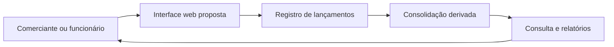
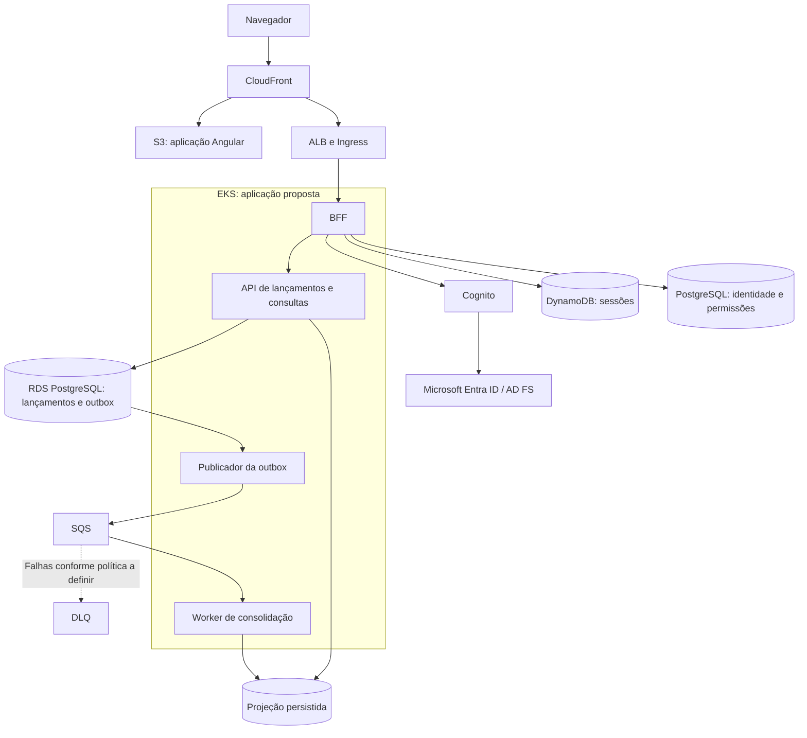

# Solução de Fluxo de Caixa

[Início](../README.md) · [Arquitetura da POC](arquitetura_poc.md) · [Guia de execução](guia_execucao.md) · [API](api.md)

Este documento apresenta o problema de negócio, as premissas e a visão da solução completa. A implementação local é um recorte dessa visão, descrito na [arquitetura da POC](arquitetura_poc.md).

## Conteúdo

- [Contexto e problema](#contexto-e-problema)
- [Premissas e domínios](#premissas-e-dominios)
- [Requisitos funcionais](#requisitos-funcionais)
- [Requisitos não funcionais](#requisitos-nao-funcionais)
- [Premissas de capacidade](#premissas-de-capacidade)
- [Decisões da solução](#decisoes-da-solucao)
- [Visão completa e recorte da POC](#visao-completa-e-recorte-da-poc)
- [Infraestrutura proposta](#infraestrutura-proposta)
- [Questões em aberto](#questoes-em-aberto)
- [Diagrama original](#diagrama-original)

## Contexto e problema

Um comerciante precisa registrar entradas e saídas e acompanhar a movimentação do caixa. A necessidade original contempla duas responsabilidades: manter os lançamentos financeiros e disponibilizar um consolidado diário para consulta.

O direcionamento central é preservar os registros oficiais e derivar deles as visões de consulta. A consolidação permite acompanhar o saldo das movimentações; a apuração de lucro contábil exige regras adicionais que não foram definidas neste escopo.

## Premissas e domínios

O levantamento inicial não incluiu uma rodada de esclarecimentos com o negócio. Assim, os itens abaixo distinguem direcionamentos de decisões ainda abertas.

| Tema | Direcionamento |
| --- | --- |
| Lançamentos / ledger | Livro de registros financeiros como fonte da verdade, com intenção de preservar um histórico imutável |
| Consolidação | Visões derivadas dos lançamentos para acompanhar entradas, saídas e saldos |
| Relatórios | Necessidade identificada; a definição como domínio separado ou consulta do ledger permanece aberta |
| Empresa | Identificação da empresa à qual o lançamento pertence |
| Perfis de acesso | Comerciante com acesso a lançamentos e relatórios; funcionário com acesso a lançamentos, como exemplo inicial |

O termo **ledger imutável** expressa a intenção da solução. A POC expõe criação e consulta, mas não implementa controles de imutabilidade no banco, trilha completa de auditoria ou um modelo de partidas dobradas. Esses conceitos não devem ser inferidos apenas da presença da outbox.

## Requisitos funcionais

| Necessidade | Escopo da visão completa | Situação na POC |
| --- | --- | --- |
| Registrar movimentações | Entradas e saídas vinculadas à empresa | Criação por API com `INCOME` e `EXPENSE` |
| Consultar lançamentos | Acesso aos registros oficiais | Listagem por empresa e mês de vencimento |
| Consultar consolidado | Visão diária do fluxo de caixa | Resumo mensal por empresa |
| Operar por interface | Interface web de lançamentos e dashboard | Interação por HTTP, sem frontend |
| Identificar a empresa | Cadastro básico da empresa | Recebe `companyId`; não há cadastro de empresas |
| Tratar antecipações | Definir impacto no fluxo de caixa | Datas de vencimento e pagamento disponíveis, sem regra específica de antecipação |
| Disponibilizar relatórios | Dashboard e possível impressão | Resposta JSON do resumo mensal |

## Requisitos não funcionais

Os valores abaixo preservam as metas do levantamento original. São requisitos pretendidos, sem comprovação de atendimento apresentada por esta POC.

| Tema | Meta ou direcionamento original | Observação de escopo |
| --- | --- | --- |
| Segurança | Autenticação, cadastro de usuários, login, recuperação de senha e autorização por perfil | Parte da visão completa; não implementada localmente |
| Desempenho | Consultas com P95 de até 800 ms e P99 de até 1 s; suporte a 100 usuários simultâneos | Necessita cenário e método de medição definidos |
| Usabilidade | Dashboard simples, funcionalidades principais em uma tela e interface responsiva para desktop, tablet e celular | Frontend fora da POC |
| Escalabilidade | Possibilidade de crescimento horizontal da aplicação e vertical do banco | O desenho contempla evolução; a POC usa uma instância local |
| Disponibilidade | 99% do tempo; deploys sem indisponibilidade desejáveis; janela de até 30 minutos para manutenções maiores | Período de apuração e tratamento das janelas ainda precisam ser definidos |
| Manutenibilidade | Estrutura de código clara e extensível | O trecho original estava incompleto; critérios adicionais permanecem em aberto |

## Premissas de capacidade

O racional original considera um cenário de pico de **50 consultas por segundo** ao consolidado diário:

| Premissa | Valor |
| --- | --- |
| Consultas por segundo | 50 |
| Consultas por minuto | 3.000 |
| Consultas por usuário ativo por minuto | 5 |
| Estimativa de usuários ativos nessa cadência | 600 |

A estimativa resulta de `50 × 60 ÷ 5 = 600`. Ela representa usuários ativos gerando consultas nessa cadência, não 600 requisições em execução ao mesmo tempo.

O requisito de **100 usuários simultâneos** e o cenário estimado de **600 usuários ativos** foram registrados em momentos distintos do raciocínio. Sua relação deve ser confirmada antes de definir um teste de capacidade. Esses números motivaram a exploração da arquitetura, mas não constituem evidência de capacidade medida.

## Decisões da solução

O histórico de escolha começou com Next.js e Python e evoluiu para **Angular no frontend** e **Java com Spring Boot no backend**. Mantém-se esse direcionamento da proposta original; não foi registrado um benchmark comparativo entre as stacks.

| Decisão | Papel na solução |
| --- | --- |
| Angular | Interface web de lançamentos e consulta |
| Java + Spring Boot | Implementação das APIs e dos casos de uso |
| BFF (Backend for Frontend) | Mediação entre a interface web e os serviços, incluindo o fluxo de sessão |
| Separação de responsabilidades | Organização em API, aplicação, domínio e infraestrutura |
| PostgreSQL | Persistência transacional prevista para a solução completa |
| Outbox e projeção assíncrona | Registro do evento junto ao lançamento e atualização posterior das consultas |
| Monólito modular na POC | Validação local das responsabilidades com menos dependências operacionais |

## Visão completa e recorte da POC

| Aspecto | Visão da solução completa | Implementação local |
| --- | --- | --- |
| Consolidação | Diária | Mensal, usando `dueDate` |
| Interface | Angular + BFF | Cliente HTTP |
| Identidade e sessão | Cognito, federação com Microsoft Entra ID / AD FS e sessão no BFF | Sem autenticação ou sessão |
| Banco transacional | PostgreSQL | H2 em arquivo |
| Mensageria | SQS no desenho original | Fila em memória |
| Modelo de leitura | Projeção persistida; o desenho registra alternativas em PostgreSQL e DynamoDB | Mapa em memória |
| Execução | Serviços na infraestrutura AWS proposta | Um processo Spring Boot |
| Recuperação | Desenho contempla mensageria e DLQ | Retry de publicação, reprocessamento manual e fallback limitado |

Os caminhos de API e nomes de classes do Excalidraw são conceituais. Os contratos disponíveis hoje estão na [referência da API](api.md).

## Infraestrutura proposta

Esta é uma visão simplificada do desenho original, sem representar recursos provisionados pelo repositório.

O Excalidraw detalha sub-redes públicas e privadas em duas zonas de disponibilidade, regras de comunicação e o fluxo de autenticação com sessão. A escolha definitiva do armazenamento da projeção e os critérios de operação em produção permanecem sujeitos a refinamento.

## Questões em aberto

- Definir a relação entre consolidado diário e mensal, incluindo saldo inicial, saldo acumulado e fechamento do dia.
- Definir correção, estorno, cancelamento e auditoria dos lançamentos dentro da intenção de histórico imutável.
- Confirmar o efeito de antecipações e pagamentos em meses diferentes do vencimento.
- Confirmar o tratamento de `CANCELLED`: o cálculo atual da POC inclui esses valores nos totais gerais, conforme a [API](api.md#regras-do-resumo).
- Refinar os limites entre relatórios e ledger, cadastro de empresas e autorização de acesso aos dados.
- Definir o cenário de carga, o período de medição de disponibilidade e os critérios restantes de manutenibilidade.

Esses pontos registram decisões pendentes e não alteram o comportamento da implementação.

## Diagrama original

O material original foi preservado como referência de concepção:

- [Abrir o arquivo editável no Excalidraw](Cashflow-2026-05-30-1130.excalidraw)
- [Abrir a exportação SVG em tamanho completo](assets/cashflow-excalidraw-diagram.svg)

O desenho reúne quatro perspectivas: autenticação e autorização, inclusão de lançamento, consulta do consolidado diário e infraestrutura. Para apresentar a implementação local, utilize os diagramas da [arquitetura da POC](arquitetura_poc.md).
